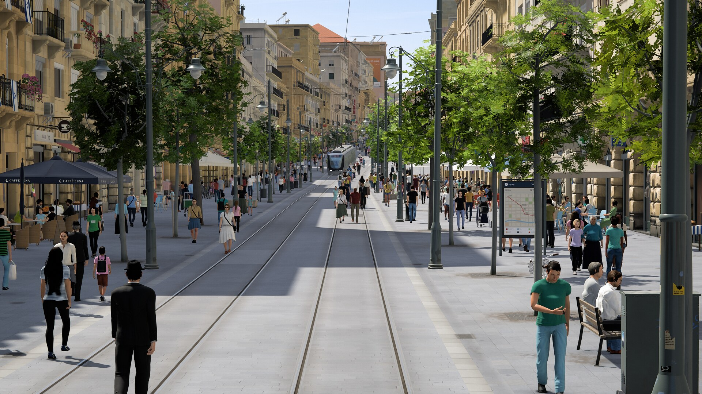
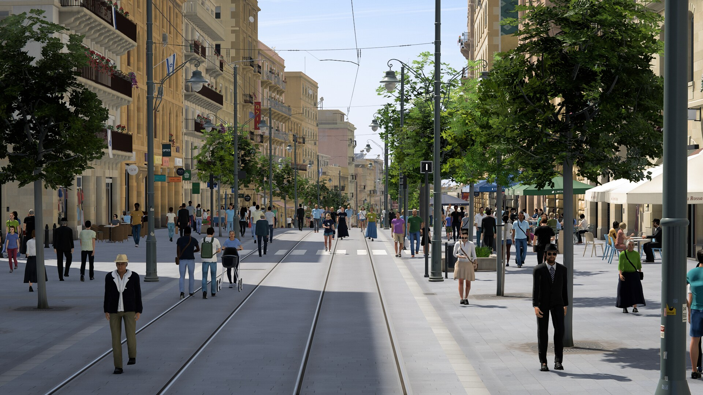
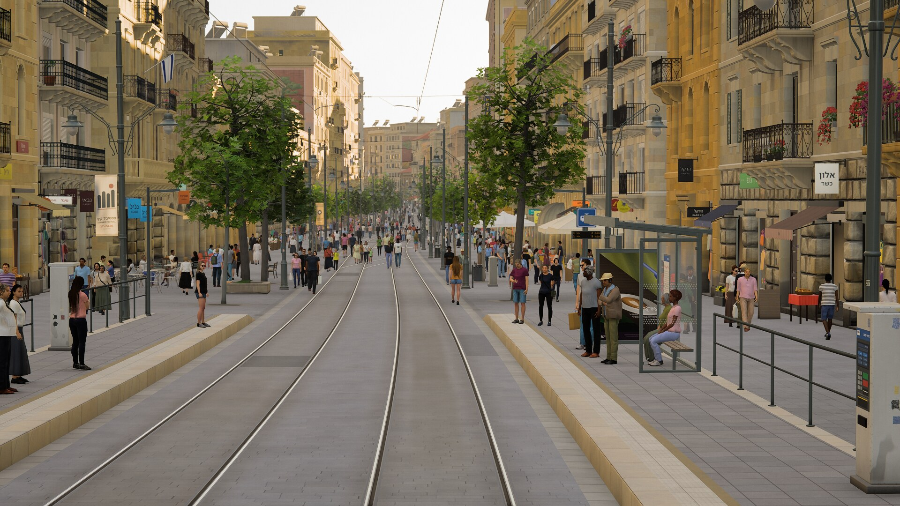
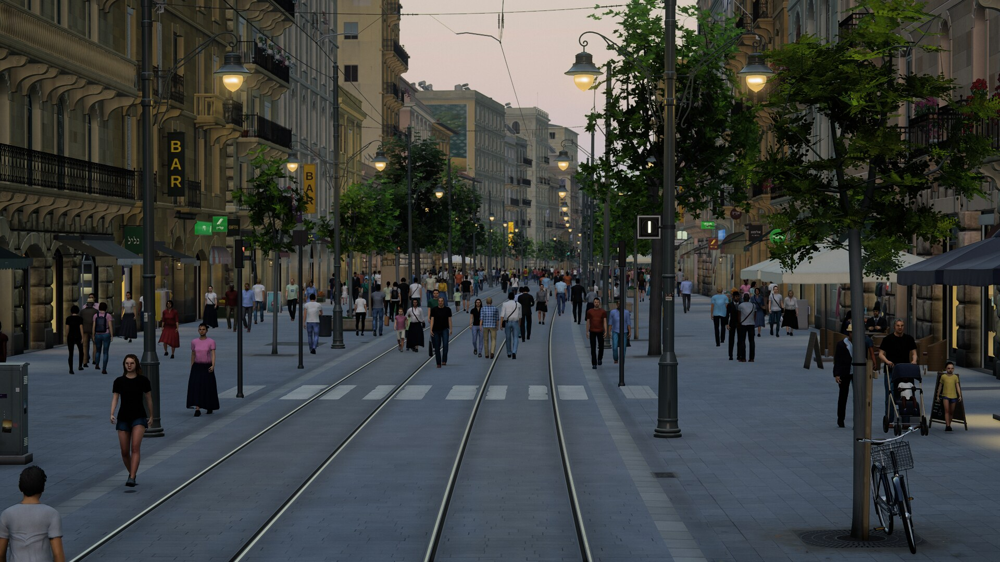
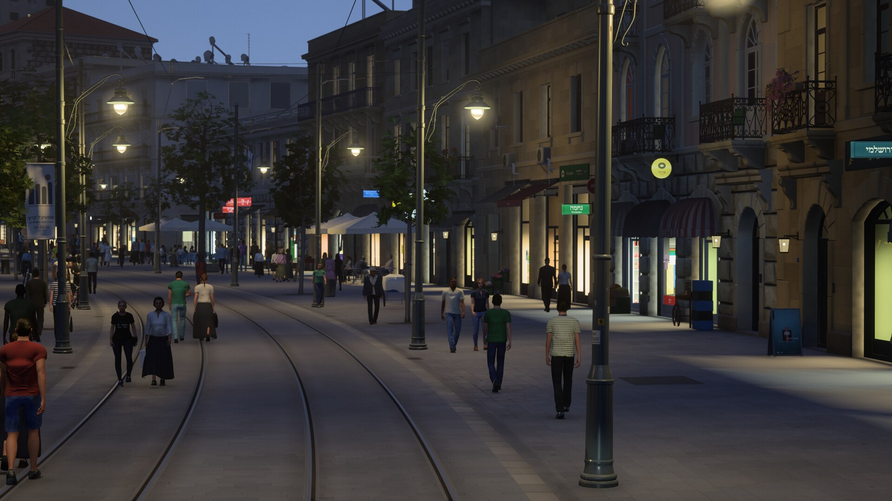
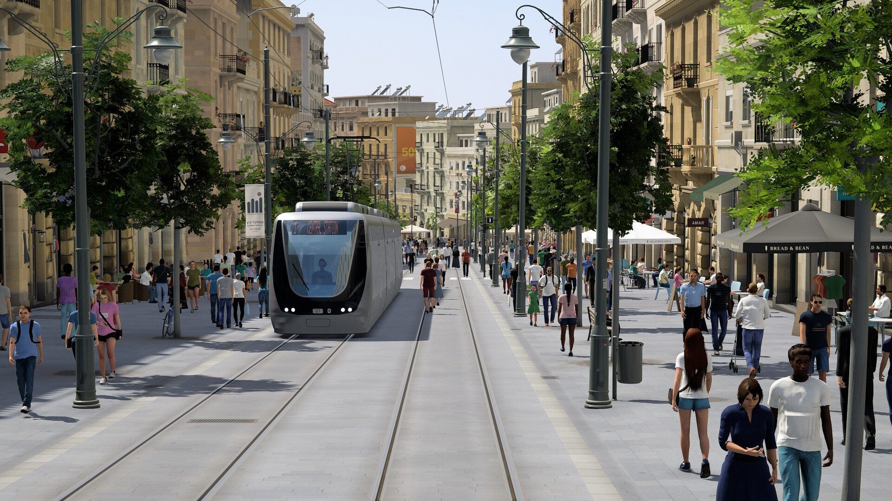
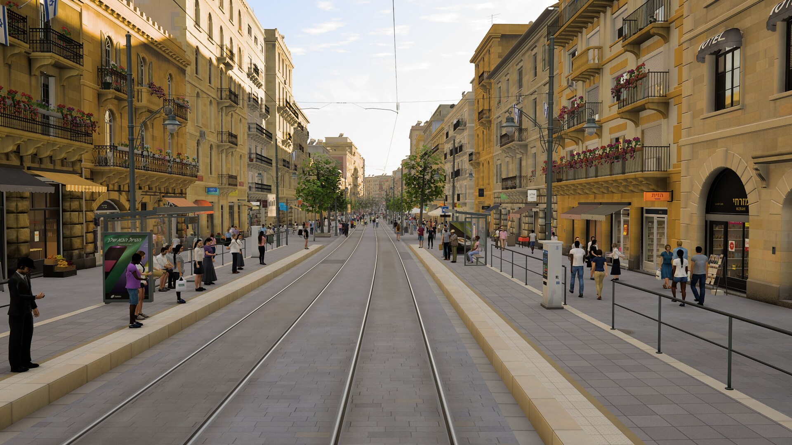
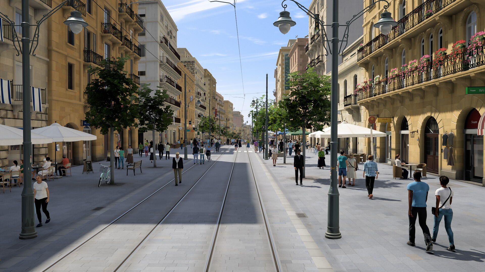
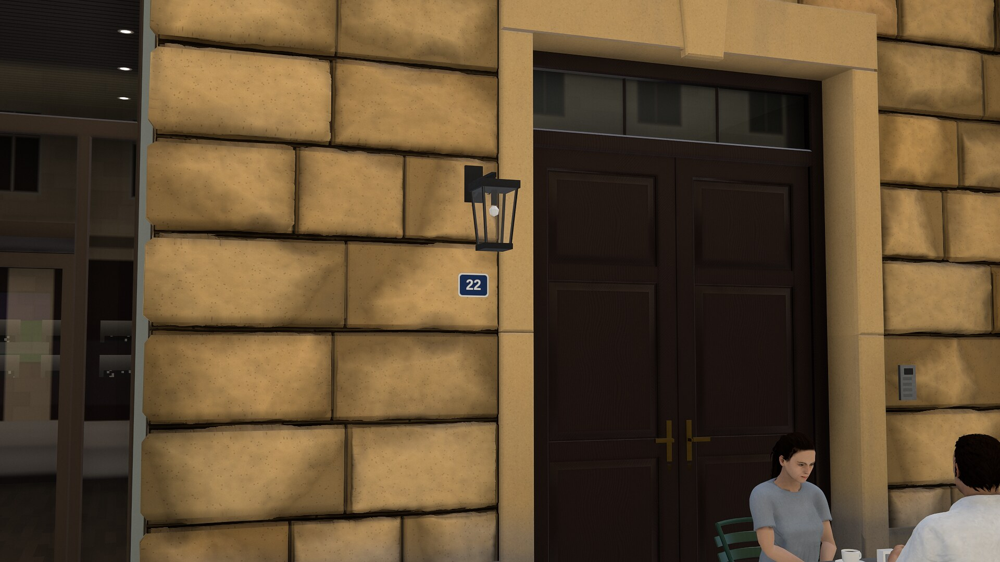
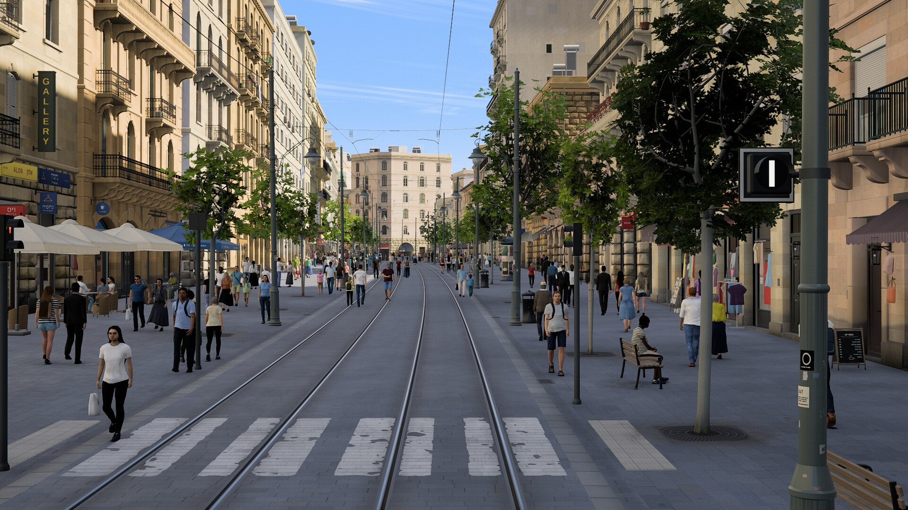

# Tramline — Cab Ride

A photoreal first-person ride in the cab of a street tram, through a historic limestone city
street, running live in the browser. The whole street — a loop of about 6 km with its
buildings, shopfronts, balconies, trees, overhead line, café terraces and several hundred
people — is generated procedurally from a deterministic plan and rendered with three.js on
WebGL 2, with no build step.

New here? Follow [From a fresh clone, step by step](#from-a-fresh-clone-step-by-step).

## Screenshots

| | |
|---|---|
| <br>Default view from the cab, early afternoon | <br>Midday on the avenue |
| <br>Golden hour at a tram stop | <br>Sunset, street lamps coming on |
| <br>Dusk with lit shops and lanterns | <br>An oncoming tram |
| <br>People at the stop (40 degree lens) | <br>Café terraces and shopfronts (40 degree lens) |
| <br>Facade close-up from the sidewalk | <br>Further down the line (28 degree lens) |

## From a fresh clone, step by step

Everything the app needs is in the repository: the code, three.js (in `vendor/three/`) and the
people's figures (`assets/humans_mh/`, about 33 MB). There is no build step and nothing else to
download or install to run it.

**1. Check what you need.** To run the app: Python 3.8 or newer, a desktop browser with WebGL 2
(Chrome, Edge or Firefox) and a GPU. It is tuned for an NVIDIA RTX-class card at 1920×1080;
on weaker or integrated GPUs add `?q=med` or `?q=low` to the URL. It runs on Linux, Windows and
macOS. The [tools](#commands) additionally use Chrome or Chromium and Docker (see
[Prerequisites](#prerequisites)). After cloning (step 2), this script checks all of it and says
what is missing and how to fix it:

```sh
tools/doctor.sh
```

It prints `OK`, `MISSING` or `WARN` for each item and ends with
`The app's requirements are met. Start it with: python3 serve.py` when you are ready to go.

**2. Get the code.**

```sh
git clone https://github.com/vladi21k/3DSceneRenderer.git
cd 3DSceneRenderer
```

`git clone --depth 1 ...` downloads only the latest version, which is much smaller than the full
history (the figures were rebuilt several times).

**3. Start the server.**

```sh
python3 serve.py
```

It prints `Serving on http://localhost:8080/  (Ctrl+C to stop)`. On Windows use `py serve.py`.
If port 8080 is taken, give another one: `python3 serve.py 9000`.

**4. Open the app.** Go to `http://localhost:8080/` in the browser. A loading screen with a
progress bar shows for about 16-17 seconds while the shaders compile (longer on a first visit or
a slower machine), then the button **Click to ride** appears. Do not open `index.html` as a file:
it must be served over HTTP.

**5. Ride.** Click the button (or press Enter). The tram rings its bell and departs; it drives
itself, stops at the stations and slows for people on the track.
- Drag with the mouse to look around; it eases back to the front when you let go.
- Mouse wheel, or `Z` / `X`, zooms between 12° and 60°.
- `W` / `S` (or the arrow keys) take over the throttle and brake; `A` hands control back to the
  automatic driver; `B` or `Space` rings the bell.
- The slider at the bottom right changes the time of day. `H` hides the interface, `M` mutes, `F` goes
  full screen. All controls: [Controls](#controls).

**6. Try other places and times.** Add parameters to the URL (all of them:
[Running it](#running-it)):
- `http://localhost:8080/?s=1450&tod=0.55` — golden hour at a tram stop
- `http://localhost:8080/?s=4100&tod=0.97` — dusk with lit shops and lanterns
- `http://localhost:8080/?fov=30` — a wider lens than the 17° default

**7. Stop.** Press `Ctrl+C` in the terminal that runs `serve.py`.

**8. Optional: the tools.** None of these are needed to run the app.

```sh
# a) a screenshot from a headless browser (needs Chrome or Chromium); writes .work/shots/x.png
python3 tools/shoot.py --params "s=1450&tod=0.55" --out .work/shots/x.png

# b) the Docker tools image (Blender, Node, ImageMagick, ffmpeg); about 3 GB, 5-15 minutes the first time
docker build -t tramline-tools:latest docker/
tools/dk bash -lc 'blender --version | head -1; node --version'

# c) a 10-second video of the ride (needs Chrome and the tools image); writes .work/movies/midday/
python3 tools/record.py --name midday --params "s=700&tod=0.1" --seconds 10

# d) rebuilding the people (needs the tools image; downloads about 330 MB, builds a 4.7 GB image);
#    this trial builds one character into .work/ and leaves the committed figures alone
tools/mh_fetch.sh
TRAM_TOOLS_IMAGE=tramline-mh:latest tools/dk blender -b -P tools/blender/mh_build.py -- \
    --stages chars,hair,tex,export --only m01 --work .work/try/mh --out .work/try/out
```

All tool outputs go to `.work/`, which git ignores. Every command and option is in
[Commands](#commands).

## Prerequisites

| Needed for | What | Install (Ubuntu) |
|---|---|---|
| Running the app | Python 3.8+ | `sudo apt install python3` (preinstalled on most systems; Windows and macOS: python.org) |
| Running the app | A browser with WebGL 2 on the GPU | Chrome, Edge or Firefox; check `chrome://gpu` says "WebGL2: Hardware accelerated" |
| Running the app | A GPU with current drivers | NVIDIA: `sudo ubuntu-drivers install` |
| Screenshots and timing (`tools/shoot.py`), videos (`tools/record.py`) | Google Chrome or Chromium on the `PATH` (`google-chrome` or `chromium`) | `wget https://dl.google.com/linux/direct/google-chrome-stable_current_amd64.deb && sudo apt install ./google-chrome-stable_current_amd64.deb` |
| Videos, checkpoint JPEGs, asset and figure builds | Docker, usable without `sudo` | `curl -fsSL https://get.docker.com \| sh`, then `sudo usermod -aG docker $USER` and log in again |
| `DK_GPU=1` (GPU inside Docker: Cycles renders) | NVIDIA Container Toolkit | [install guide](https://docs.nvidia.com/datacenter/cloud-native/container-toolkit/latest/install-guide.html), then `sudo nvidia-ctk runtime configure --runtime=docker && sudo systemctl restart docker` |
| Rebuilding the people | Docker image `tramline-mh` and about 8 GB of disk for both images | `tools/mh_fetch.sh` (after building `tramline-tools`) |
| Committing checkpoints | git | `sudo apt install git` |

The app was tested on Linux with Chrome and an RTX 4060 Ti; the Docker tools were tested on
Linux. On Windows, the tools can run inside WSL 2 with Docker Desktop.

## Troubleshooting

- **Black page, or "WebGL 2 is not available".** The browser is not using the GPU. Open
  `chrome://gpu`: it should say "WebGL2: Hardware accelerated". Turn on hardware acceleration
  in the browser settings and update the GPU driver.
- **Nothing loads when opening `index.html` directly.** The page loads ES modules, which browsers
  block from `file://`. Start `python3 serve.py` and use `http://localhost:8080/`.
- **"Address already in use".** Another program holds port 8080. Use another port:
  `python3 serve.py 9000`, then `http://localhost:9000/`.
- **Slow first load, or stutter while riding.** The first load compiles about 140 shaders (about
  16-17 s on the reference machine, more on slower ones). On integrated or older GPUs use
  `?q=med` or `?q=low`.
- **Stuck on the loading screen.** Open the browser's developer console (F12): an error there
  names the failing module. `python3 tools/shoot.py` prints the same console errors.
- **`tools/shoot.py`: Chrome not found.** Install Google Chrome or Chromium so that
  `google-chrome` or `chromium` is on the `PATH`.
- **Docker: "permission denied" on the socket.** Add yourself to the `docker` group
  (`sudo usermod -aG docker $USER`) and log in again.
- **Docker: "could not select device driver" with `DK_GPU=1`.** Install the NVIDIA Container
  Toolkit (see Prerequisites). Without `DK_GPU=1` everything except GPU rendering still works.
- **`tools/dk` seems to hang the first time.** It is building the tools image (about 3 GB,
  5-15 minutes); later runs start in a second.
- **Where did the output go?** Screenshots, videos and build work files are under `.work/`
  (`.work/shots/`, `.work/movies/`, `.work/mh/`).

## Running it

**Requirements:** a desktop browser with WebGL 2 and a discrete GPU. Tested on Chrome on
Linux with an NVIDIA RTX 4060 Ti.

```sh
python3 serve.py            # prints: Serving on http://localhost:8080/
python3 serve.py 9000       # optional port (and a second argument: bind address)
```

Open the URL it prints (`http://localhost:8080/`). Any static file server rooted at the
repository works as well (for example `python3 -m http.server 8080`); the page must be served
over HTTP, not opened as a file, because it loads ES modules. `serve.py` only adds no-cache
headers and a deep request queue, since the app fetches about 200 modules at once.

The first load downloads the human figures (about 33 MB) and takes about 16-17 s on a quiet
machine before the "Click to ride" screen appears, most of it spent compiling shaders. Click
to start: the tram departs from a standstill with a bell, and sound starts.

**URL parameters** (core ones in `src/core/params.js`, the rest in `docs/ARCHITECTURE.md`),
e.g. `http://localhost:8080/?s=1450&tod=0.55&fov=28`:

| Parameter | Meaning |
|---|---|
| `s=<m>` | start position along the route in metres (wraps round the loop) |
| `tod=<0..1>` | time of day: 0 midday, 0.55 golden hour, 0.8 sunset, 1 dusk (default 0.12) |
| `fov=<deg>` | vertical field of view, honoured exactly (default 17°, a telephoto) |
| `speed=<km/h>` | starting speed (the automatic driver then picks its own cruise speed) |
| `auto=0\|1` | automatic driving (default 1) |
| `freeze=1` | freeze the simulation clock (a still frame that keeps rendering) |
| `capture=1` | no interface, no start click and no sound (used for screenshots) |
| `q=low\|med\|high` | quality preset (default high; see Performance) |
| `seed=<int>` | world seed (default 7); the content is identical on every visit |
| `view=s,d,h,yaw,pitch` | free inspection camera in route coordinates (metres, degrees); e.g. `view=430,9,1.7,-60,8` stands on the right sidewalk looking at the facades |
| `only=a,b` / `skip=a,b` | enable only / disable the named modules (`street`, `buildings`, `facades`, `ironwork`, `vegetation`, `catenary`, `furniture`, `trams`, `humans`, `crowd`, `ui`, `audio`, `post`, `farfield`); materials, env, train and cameraRig always load |

Also `debug=1` (stats overlay) and `rec=<fps>` (fixed-step recording, see Tooling). The
modules read a few inspection switches of their own: `sky=streaks|cumulus|haze` (cloud regime),
`tram=<s>` (first oncoming tram's position), `prof=1` (post-processing GPU timers), `taa=0`,
`taaj=<px>` and `sharp=<k>` (anti-aliasing and sharpening), `ffnear=<m>` (far field starts
nearer), `audio=1` (sound even with `capture=1`), `audiocache=0` (re-synthesise the sound bank),
`glbox=0` (three's own scalar uniform uploads), and the light and sky values `mie`, `mieh`,
`miealb`, `mieg`, `alt`, `hlev`, `hslope`, `skychroma` and `skysat`. `docs/ARCHITECTURE.md`
lists these and the remaining comparison switches.

## Controls

| Input | Action |
|---|---|
| Click on the start screen (or `Enter` / `Space`) | start the ride (the tram departs with a bell; audio starts) |
| `W` / `↑` | master controller one notch towards power |
| `S` / `↓` | master controller one notch towards brake |
| `A` (or the Auto/Manual button) | toggle automatic driving |
| `B` / `Space` | ring the bell |
| Drag with any mouse button | look around (grab the view); eases back to centre when released |
| `Z` / `X` (held), mouse wheel | zoom in / out |
| Time-of-day slider (bottom right) | midday to dusk |
| Lens slider (bottom right) | zoom, shown as a 35 mm-equivalent focal length |
| `H` | hide / show the interface |
| `M` | sound on / off (remembered by the browser) |
| `F` | full screen |

- The controller has ten notches: `EB` (emergency), `B4`-`B1`, `N`, `P1`-`P4`. Holding `W` or
  `S` steps about six notches a second. In automatic mode either key switches to manual
  driving: the controller takes the notch nearest the current effort and then steps from there.
- In manual mode station stops are still automatic, and a speed supervisor keeps the tram
  within curve and switch limits. After the dwell the tram departs by itself if the
  controller is at `N`; with a brake notch selected it waits for `W`. Hold `W` to run
  through a stop.
- Mouse look has soft limits of about 60° to either side and 25° up or down. Zoom covers
  12°-60° of vertical field of view (about 21-114 mm equivalent; the default 17° is about
  80 mm).
- Letter keys follow the printed keyboard layout; keys with Ctrl, Alt or Cmd are ignored.
- The HUD (bottom left) shows the speed and any lower speed limit, the controller strip,
  the driving mode and the distance to the next stop or the door state at a platform.

## How it was built

Plain ES modules on a vendored three.js r186. Each part is a module loaded by dynamic import
(`src/main.js`); a module that fails is logged and disabled while the rest keeps running.
Module contracts are in `docs/ARCHITECTURE.md`.

**Route and layout plan** (`src/world/route.js`, `src/world/layout.js`, `src/core/config.js`,
`src/core/rng.js`). The line is a closed loop of about 6 km built from straights, clothoid
transitions and circular arcs, with gentle S-meanders so no street is ruler-straight, and
designed hills (the avenue ahead of the start climbs about 21 m at about 5.8 %). Everything is
placed in route coordinates (distance along the street, lateral offset, height). Two
standard-gauge tracks run at ±1.6 m from the centre line; the camera rides the right one.
A deterministic master plan, computed once from a seeded random generator, places the
stations and side platforms, crossovers, cross streets, building lots, poles, trees, about 250
café terraces, street furniture and the obstacles the crowd avoids. The ground has a sidewalk
cross-fall, a slow hillside tilt and settlement undulation, and every object stands on it.

**Chunk streaming, LODs and start-up** (`src/world/streaming.js`, `src/core/farfield.js`,
`src/main.js`). The route is streamed in 40 m chunks: full detail within 200 m, a lighter
level out to 680 m, and a far field out to 1400 m, built from the same plans as merged blocks
with one draw call per chunk that shades itself as a street canyon beyond the sun's shadow
range. Builds are time-sliced (about 7 ms per frame, nearest first), and chunks crossing a
level boundary are rebuilt and swapped without gaps. During the ride a new chunk's shader
programs compile in the background and its vertex buffers go to the GPU ahead of time within a
2 MB per-frame budget, so no frame uploads a whole chunk. At start-up the module inits overlap
the shader compile (programs are queued as soon as they are known), every program gets its
first draw before the ride starts, and readiness gates (the texture bake, the foliage atlas)
keep anything from popping in.

**Procedural GPU-baked PBR materials** (`src/materials/`: `baker.js`, `recipes/`,
`library.js`, `surface.js`). Every tileable surface texture is baked on the GPU at start-up from a GLSL recipe
evaluated per texel (albedo, roughness, normal, height, occlusion): limestone ashlar and
rock-faced stone, grey granite setts, rail steel, iron, glass, canvas, wood, paint, plaster,
roof tiles, bark, leaves and the rest of a library of about forty materials. A runtime patch
on three.js's standard materials removes tiling (row layouts with per-row shifts and per-block
tone, mirrored map lookups), adds chisel dressing, weathering (soiled ledges, run-off streaks
down walls), grime lanes along the rails, gum spots and spill blots, specular anti-aliasing
from the baked normal variance, and parallax-occlusion relief with self-shadowing on
rock-faced stone. UVs are in metres everywhere.

**Buildings and facade plans** (`src/world/facadePlan.js`, `src/world/buildings.js`,
`src/world/buildings/`). `facadePlan(lot)` is the architectural description of each front,
shared by every module that dresses it: floors (mostly 4-6, from 2 to 9), bays of varying
rhythm, openings (shops, doors, windows, balcony doors with flat, round, segmental or pointed
heads, arcaded triple lights), balconies, string courses, cornice, parapet, roof, rooftop
clutter and style. The street mixes late-Ottoman and Mandate-era ashlar fronts with about a
quarter of later blocks (wide flat windows, slab balconies, many rendered and colour-washed),
neighbours in different stone tones, and towers or landmarks where a view ends. The shell
builder turns each plan into masonry: walls with real openings and reveals, coursing aligned
across the front, arches with voussoirs and keystones, surrounds, sills, cornices with dentils
and modillions, parapets or tiled roofs, rustication, quoins, pilasters, corner returns, party
walls, murals and set-back upper storeys, built as time-sliced jobs.

**Facades, shopfronts, signs and interiors** (`src/world/facades.js`, `src/world/facades/`).
Windows, doors, shutters (louvred and roller), shopfronts and awnings follow each opening's
outline. Window glass reflects a traced stand-in of the street and shows a room traced per
pixel behind it (homes about 4 m deep, shops about 7 m), with furniture, shelving with goods,
mannequins and curtains, lit by daylight through the opening and by lamps at dusk; lit shops
then light their reveals and the pavement in the colour of their own lamps (2700-5000 K by
trade). A canvas atlas of invented shop names (Hebrew lettering over an English
transliteration), trade words, phone numbers, posters and price cards feeds fascia boards,
projecting light boxes, discs and blades. Trades put goods out on the pavement (produce,
flowers, clothes racks, newspapers, bakery trays, sacks, shoes, books), registered as crowd
obstacles.

**Ironwork and balconies** (`src/world/ironwork.js`, `src/world/ironwork/`). Moulded stone
balcony slabs on carved consoles placed clear of the window dressing below, wrought-iron
railings or stone balustrades, planters, AC units, flags and satellite dishes. Railings are
instanced geometry near the camera and coverage cards far away that fade in under the bars.
Level of detail is chosen per instance from its projected size, so it follows the zoom. The
railings' rust pattern is shared with the stains on the wall below, and everything is drawn
street-wide in a few batches rather than per chunk.

**Street, track and paving wear** (`src/world/street.js`, `src/world/street/`). Granite setts
in the track corridor, light stone edge bands, gutters and sidewalks with camber and
unevenness; 3D grooved rails up close (polished running band, oxidised field side, grit in the
flangeway) and anti-aliased rail lines far away; crossovers with switches and frogs, cross
streets with kerbs, cast-iron covers, drains and road markings. Wear is placed per chunk:
relaid stretches of setts, asphalt and concrete repairs, a drip band along each track, oil
under the bogies where trams stand at the stops, rust halos round covers, gutter silt and weeds.

**Trees** (`src/world/vegetation.js`, `src/world/vegetation/`). Young pagoda trees,
narrow-leaved ash and hackberry or fig-like trees, with some old ones, grown once at start-up
by space colonisation inside a crown envelope, with pipe-model branch radii, bark tubes with
collars and three detail levels. Leaf cards carry shoot tips from a leaf atlas painted on CPU
canvases in workers. Trees are instanced along the street with per-tree scale, lean, yaw and
tint. The shaders add wind (trunk sway, branch motion, leaf flutter, matched in the shadow
pass), light passing through the crown, sky occlusion inside it and leaf translucency.

**Lamps, catenary and street furniture** (`src/world/catenary.js`, `src/world/catenary/`,
`src/world/furniture.js`, `src/world/furniture/`). Ornate lamp standards with forged lyre
brackets and globe lanterns that switch on as the light fades; an overhead contact line with a
staggered contact wire per track at 6 m, cross-span wires with insulators, droppers,
registration arms and pull-offs on curves; pole banners; pedestrian signals that turn red as a
tram approaches. All of it is instanced street-wide, with detail chosen per standard by
on-screen size. The furniture module places café terraces (tables, chairs, market umbrellas,
place settings), tram-stop platforms and shelters, benches, bins, bollards, kiosks, advert
columns, bike racks, ticket machines, A-boards, utility cabinets, vendor carts and parked
vehicles in the cross streets, as batched instances with cross-faded detail levels.

**Human figures** (`src/crowd/humans.js`, `src/crowd/humans/`, `tools/blender/mh_*.py`,
`assets/humans_mh/`). A cast of 49 dressed characters (men, women, teens, children, the
elderly and toddlers, in summer clothing) is built from the MakeHuman CC0 system assets with
the MPFB2 add-on in headless Blender, inside the project's Docker tools image (the variant from
`docker/Dockerfile.mh`). `mh_build.py` runs the stages: bodies from shape macros and targets,
CC0 clothes, hair and eyes with garment edits and skin weights converted to a 22-bone runtime
skeleton; strand-card hair groomed over each scalp; shared texture arrays with synthesised
clothing folds; four LODs per character, per-vertex occlusion and quantised geometry
(`cast.json`, `cast.bin.gz`, WebP texture strips). In the browser an appearance seed picks a
character and varies clothing colours and patterns, hair, skin, height, face shape, glasses,
bags and stance. Walk, idle and sitting clips are baked once and blended on the CPU into
bone matrices in a float texture; the figures are skinned on the GPU and drawn as instances of
one batched mesh (a single multi-draw call per pass, coarser LODs in the shadow cascades),
with a contact shade under the feet. Strollers with rolling wheels and bicycles with turning
cranks are attached props, and parked bicycles stand at the racks.

**Crowd behaviour** (`src/crowd/crowd.js`, `src/crowd/behaviour/`). Up to 980 people are kept
from 42 m behind the cab to 560 m ahead, spawned where they cannot be seen and recycled behind.
About half of those on foot walk in pairs and threes, talking in turns; children walk hand in
hand; café parties sit down and leave together and waiters serve the tables; passengers wait
at the platforms; others browse shop windows and goods stands, go up side streets, push
strollers or ride bicycles. Steering uses social forces around obstacles and walls, people
obey the pedestrian signals, clear the tracks ahead of every tram with a margin outside the
cab's swept volume, react to the bell and never pass through the camera. New people avoid
cast characters already in use within 20 m.

**Tram ride dynamics and the fixed cab camera** (`src/ride/train.js`, `src/ride/cameraRig.js`,
`src/ride/trams.js`, `src/ride/trams/`, `src/ride/ui.js`, `src/ride/input.js`). The tram is a
32 m five-module low-floor vehicle: constant torque up to 32 km/h, then constant power to a
50 km/h governor, running resistance and the route grade, and jerk-limited traction and
braking. The automatic driver cruises at 40-45 km/h on a clear corridor and 23-28 km/h when
people walk in it, keeps curve and 25 km/h crossover limits, coasts into braking curves, stops
at the platforms (12-18 s dwell with doors and a bell) and brakes, rings and creeps for people
on the track. The camera is mounted on the cab body at 2.75 m eye height, 1.7 m behind the cab
front, and never pans towards the line ahead, like a fixed cab-ride camera; it carries body
sway, hunting, bob, roll in curves, pitch under braking, knocks at rail joints and turnout
parts (the same ones the audio plays), a fine running shake and a shutter time for motion blur
(1/160 s by day to 1/50 s at dusk). The cab tram is never drawn but casts its shadow. Two
oncoming trams run the loop the other way with the same driving model, see-through glazing
over a modelled saloon with passengers, and paint and glass that reflect the street.

**Sky, lighting, shadows and post-processing** (`src/env/`). A physically based atmosphere
(transmittance, multiple-scattering and sky-view lookup tables) with dust aerosol and a low
urban haze; volumetric cumulus ray-marched at half resolution and cirrus layers, in one of
three weather regimes per seed; real solar geometry for early September at 31.8° N mapped onto
the afternoon. Image-based lighting comes from an HDR cube of the sky over a street-canyon
model, with bounce light from sunlit facades. At dusk a pool of real spot lights follows the
nearest lanterns (about 3300 K), more distant lamp pools are added in screen space, and the
tram's dipped headlight lights the rails. The sun casts four cascades fitted to the field of
view out to 700 m, with penumbrae that harden towards contact; static casters are merged into
depth-only proxies in the background. The post chain works like a camera: HDR scene with MSAA
and sub-pixel jitter, SSAO, aerial perspective and heat shimmer, temporal anti-aliasing (16
jitter samples, reprojection of moving trams, cyclists and walkers), depth of field for a
1-inch sensor, camera and per-object motion blur, bloom, metered exposure, lens veil,
highlight recovery, sharpening, white balance, a camera tone curve with AgX colour, and grain.

**Synthesized audio** (`src/ride/audio.js`, `src/ride/audio/`). No recorded samples: every
sound is synthesised with WebAudio: sample buffers in workers (cached in IndexedDB), endless
noise and the inverter's PWM live in AudioWorklets. Layers: the two-strike bell, rolling noise and wheel knocks at the same rail
joints and turnout parts as the camera, curve squeal, the traction inverter whine and gear
mesh, brakes and doors, the oncoming trams passing, and street ambience driven by the real
crowd (conversations placed at the people talking, footsteps, birds), mixed through cab and
street reverbs and spatialised.

## Commands

All commands run from the repository root. The app itself needs only Python 3 (or any static
server) and a browser. `tools/shoot.py` and `tools/record.py` need Python 3 and Chrome on the
`PATH` (`google-chrome` or `chromium`); video encoding, the checkpoint JPEGs and the asset tools
run in the Docker tools image (`DK_GPU=1` also needs the NVIDIA Container Toolkit).

### Run the app

```sh
python3 serve.py                 # http://localhost:8080/ (listens on every interface)
python3 serve.py 9000            # another port
python3 serve.py 8080 127.0.0.1  # this machine only
python3 -m http.server 8080      # or any static server rooted at the repository
```

Open `http://localhost:8080/`, wait for "Click to ride" and click. URL parameters go after `?`,
for example `http://localhost:8080/?s=1450&tod=0.55&fov=28` (see [Running it](#running-it)).
Ctrl+C stops the server.

To serve it from the tools image instead of the host's Python (port 8080 published on every
interface; `-p 127.0.0.1:8080:8080` keeps it to this machine; Ctrl+C stops it):

```sh
docker run --rm -it -p 8080:8080 -u "$(id -u):$(id -g)" -v "$PWD:/work" -w /work \
  tramline-tools:latest python3 serve.py 8080 0.0.0.0
```

### Docker tools image

`docker/Dockerfile` builds `tramline-tools:latest` (Ubuntu 24.04, Blender 4.5 LTS, Node 24,
Python 3 with numpy, scipy and Pillow, ImageMagick, ffmpeg, gltf-transform). It is only for
offline asset work and video encoding; the app does not need it.

```sh
docker build -t tramline-tools:latest docker/      # build it explicitly (tools/dk also builds it on first use)
tools/dk <command> [args...]                       # run a command in it, repository mounted at /work, as your user
tools/dk bash -lc 'blender --version | head -1; node --version; ffmpeg -version | head -1'
tools/dk blender -b --factory-startup -P tools/blender/<script>.py -- <args>   # headless Blender script
tools/dk node <file.mjs>                           # plain-JS checks (no three.js import map here)
tools/dk python3 <script.py>                       # Python with numpy / scipy / Pillow
tools/dk convert in.png -strip -quality 88 out.jpg # ImageMagick
tools/dk ffmpeg -i in.mp4 ...                      # ffmpeg
tools/dk gltf-transform inspect model.glb          # glTF tools
DK_GPU=1 tools/dk <command>                        # add the NVIDIA GPU (Cycles rendering, baking)
TRAM_TOOLS_IMAGE=<image> tools/dk <command>        # use another image (e.g. tramline-mh:latest)
docker run --rm -it -u "$(id -u):$(id -g)" -v "$PWD:/work" -w /work tramline-tools:latest bash   # a shell in it
```

`tools/dk` runs without a terminal (`docker run -i`, no `-t`), so use the last line for an
interactive shell. If the image it is asked for (`TRAM_TOOLS_IMAGE`, default
`tramline-tools:latest`) does not exist, it builds `docker/Dockerfile` under that name.

### Human-figure image and cast build

The crowd's figures (`assets/humans_mh/`, committed) are built from the MakeHuman CC0 system
assets with the MPFB2 add-on in headless Blender. Rebuilding them is optional.

```sh
tools/mh_fetch.sh          # download MPFB2 and the MakeHuman CC0 assets (about 330 MB) into docker/mh/, build tramline-mh:latest

# full build: characters, strand hair, textures, export to assets/humans_mh/ (work files in .work/mh/)
TRAM_TOOLS_IMAGE=tramline-mh:latest tools/dk blender -b -P tools/blender/mh_build.py -- \
    --stages chars,hair,tex,export --jobs 8

# only some characters, e.g. rebuild two characters and re-export the whole cast
# (needs the work files of an earlier full build in .work/mh/, see below)
TRAM_TOOLS_IMAGE=tramline-mh:latest tools/dk blender -b -P tools/blender/mh_build.py -- \
    --stages chars,hair,tex,export --only m01,f02

# a trial build of one character into scratch folders (about 30 s; assets/ untouched)
TRAM_TOOLS_IMAGE=tramline-mh:latest tools/dk blender -b -P tools/blender/mh_build.py -- \
    --stages chars,hair,tex,export --only m01 --work .work/try/mh --out .work/try/out

# strand-card hair on its own (then run --stages tex,export to use it)
TRAM_TOOLS_IMAGE=tramline-mh:latest tools/dk blender -b -P tools/blender/mh_hair.py -- --only m01,f02 --jobs 8

# Cycles lineup render of the exported cast (front / side / back) into .work/mh/preview/
TRAM_TOOLS_IMAGE=tramline-mh:latest DK_GPU=1 tools/dk blender -b -P tools/blender/mh_preview.py -- \
    --lod 0 --views front,side,back --samples 64
```

`tramline-mh:latest` is built on top of `tramline-tools:latest`, so build that first. Run
`tools/mh_fetch.sh` before any `TRAM_TOOLS_IMAGE=tramline-mh:latest` command: `tools/dk` would
otherwise build the plain tools image, without MPFB2, under that name.

Options of `mh_build.py`: `--stages` (any of `chars,hair,tex,export,preview`; default all five),
`--only <ids>` (comma-separated), `--jobs N` (parallel Blender processes for `chars` and
`hair`, default 8), `--blend` (also save `<work>/raw/<id>.blend`), `--work DIR` (default
`.work/mh`), `--out DIR` (default `assets/humans_mh`). `--only` limits `chars` and `hair`;
`tex` and `export` always take every character found in `<work>/raw/`, so with an empty work
folder the exported cast holds only the characters just built: keep `--out` away from
`assets/humans_mh` for such a build. Do not pass `--factory-startup` with this image: it would
disable the MPFB2 add-on. The character list (49 ids such as `m01`, `f02`, `c01`) is in
`tools/blender/mh_cast.py`. `mh_hair.py` takes `--only`, `--jobs` (default 8) and `--work`.

Options of `mh_preview.py`: `--lod 0..3` (default 0), `--only <ids>`, `--views` (any of
`front,side,back,threeq`), `--samples` (default 48), `--res` (image width, default 2400),
`--rows` (default 3; one image per view and row, `lineup_<view>_lod<L>_row<r>.png`), `--src DIR`
(default `assets/humans_mh`), `--out DIR` (default `.work/mh/preview`), `--cpu`. Images are named
`lineup_<view>_lod<L>.png`, with `_row<r>` added when the lineup needs more than one row.

### Screenshots, timing and profiling: `tools/shoot.py`

Starts a private static server (unless `--port` is given) and headless Chrome on the GPU,
opens the page with `capture=1` added to `--params`, waits for the app to report ready
(`window.__ready`), then takes screenshots and prints the app's frame stats (the `stats:` line)
and console errors and warnings. Chrome and the server are always killed at the end, also on
Ctrl+C, `timeout` or a crash.

```sh
python3 tools/shoot.py --params "s=420&tod=0.55" --out .work/shots/x.png         # one screenshot
python3 tools/shoot.py --params "s=700&speed=40" --shots 4 --interval 0.5 --out .work/shots/seq.png   # seq_00.png ... seq_03.png
python3 tools/shoot.py --params "s=1540&speed=60" --shots 0 --settle 35 --hitches  # 35 s ride timing and hitch log
python3 tools/shoot.py --params "s=1700&speed=45" --shots 0 --settle 30 --heapprof 30   # allocation profile
python3 tools/shoot.py --shots 0 --cpuprof 30                                      # start-up CPU profile
python3 tools/shoot.py --params "s=1540&speed=60" --shots 0 --settle 30 --firstdraw --profile .work/prof   # first-draw audit
python3 tools/shoot.py --params "speed=0" --shots 0 --eval "JSON.stringify(window.__app.stats())"          # evaluate JS
python3 tools/shoot.py --page tools/textures/preview.html --params "mode=wall"     # material preview page
python3 tools/shoot.py --reap                                                      # kill browsers left by crashed runs
```

| Option | Meaning |
|---|---|
| `--params Q` | URL query for the app, without `?` |
| `--page P` | page to open (default `index.html`) |
| `--out PATH` | screenshot path (default `.work/shots/shot.png`); with `--shots` above 1 the files are `<name>_00.png`, `<name>_01.png`, … |
| `--width W`, `--height H` | viewport (default 1920×1080) |
| `--shots N`, `--interval S` | number of screenshots (default 1; 0: none) and seconds between them (default 1) |
| `--settle S` | seconds to wait after ready before the first shot (default 1.5; the ride runs during this time) |
| `--timeout S` | seconds to wait for ready (default 240) |
| `--force` | take the screenshots even if the app never became ready |
| `--eval JS` | JS expression evaluated after the shots, result printed (a returned promise is awaited, e.g. `(async () => { ... })()`) |
| `--pre JS` | the same, right after ready, before `--settle` |
| `--init JS` | evaluate JS in the page before its own scripts |
| `--console` | print every console message, not only errors and warnings |
| `--hitches` | frame-time summary and a log of frames over 50 ms with their cause |
| `--fps N` | cap the frame rate at N, as vsync would (default 60 with `--hitches`, `--heapprof` or `--heaplive`, otherwise uncapped; 0: uncapped) |
| `--heapprof N` | top N JS allocation sites (garbage included) from ready to the end |
| `--heaplive N` | top N allocation sites still alive at the end |
| `--heapdelay S` | with `--hitches`, `--heapprof` or `--heaplive`: start sampling S seconds after ready |
| `--snapshot PATH` | collect garbage and save a heap snapshot at the end |
| `--cpuprof N` | top N source files and functions by self time from navigation to ready |
| `--firstdraw` | list programs first drawn after ready (each one stalls a riding frame) |
| `--profile DIR` | keep a Chrome profile (and its shader cache) between runs |
| `--port N` | use an already running server on this port (also `TRAM_PORT`) |
| `--max-seconds S` | hard limit for the whole run, then exit 124 (default `--timeout` + `--settle` + `--shots` × (`--interval` + 5) + 900; 0: no limit) |
| `--keep-open` | keep the browser open until Enter is pressed (no time limit then) |
| `--reap` | only kill headless browsers and static servers left behind by earlier runs whose tool is gone, then exit (every run does this first) |

Environment: `SHOOT_CHROME_FLAGS` adds Chrome switches, `SHOOT_GPU_FLAGS` replaces the GPU
switches (default `--enable-gpu --ignore-gpu-blocklist --use-angle=gl`), `SHOOT_STDERR=<file>`
keeps Chrome's own output. Exit codes: 0 done, 1 the app never became ready (or reported a
fatal error), 2 Chrome did not start, 3 console errors or exceptions, 124 `--max-seconds`
passed, 130 Ctrl+C.

### Videos: `tools/record.py`

Renders the ride frame by frame with fixed time steps (`rec=<fps>`), so the video plays
smoothly however long each frame takes, then encodes it with ffmpeg in the tools image.

```sh
python3 tools/record.py --name midday --params "s=700&tod=0.1" --seconds 40
python3 tools/record.py --name dusk --params "s=4000&tod=0.95" --seconds 30 --fps 30
python3 tools/record.py --name dusk --encode-only     # re-encode frames already recorded
```

Output, all in `.work/movies/<name>/`: `frames/00000.jpg`, `00001.jpg`, … (cleared at the
start of each recording under that name), `<name>_1080p.mp4` and `<name>_phone.mp4` (1280×720,
at most about `--phone-mb`). Options: `--name` (default `ride`), `--params`, `--seconds`
(default 30), `--fps` (default 30), `--warmup` (frames stepped before recording, default 60),
`--width`, `--height` (default 1920×1080), `--quality` (JPEG of the frames, default 94),
`--phone-mb` (size of the small copy, default 3), `--no-encode` (frames only), `--encode-only`,
`--timeout` (seconds to wait for ready, default 250), `--max-seconds` (limit for the browser
part, default `--timeout` + 2 s per frame, warm-up included, + 900; 0: no limit). With
`--encode-only`, pass the recording's `--fps` and `--seconds` as well: the video's frame rate
and the phone copy's bitrate are computed from them (the defaults are 30 and 30).

### Progress checkpoints: `tools/checkpoint.sh`

```sh
mkdir -p .work                                                  # git-ignored, so missing in a fresh clone
nohup tools/checkpoint.sh 1200 >> .work/checkpoint.log 2>&1 &   # every 20 minutes (1200 s is the default)
echo "what is being worked on" > .work/checkpoint_note.txt      # stage line for the commit messages
pkill -f tools/checkpoint.sh                                    # stop it
```

The argument is the interval in seconds; the first run comes one interval after the start.
Each run takes three screenshots in parallel with `tools/shoot.py` (the default view and two
views that rotate through route positions and times of day) into `.work/shots/auto/<HHMM>/`,
converts them to JPEG with `tools/dk convert`, then stages everything with `git add -A`
(untracked files included; `.work/` is ignored) and commits it with a message listing the
changed areas, files and line counts and the first line of the note file (default "work in
progress"). Runs with no changes make no commit. Each run appends one `CHECKPOINT <dir> …` line
to the log. `pkill` stops the loop; screenshots already started finish on their own (each is
limited to 400 s).

### Material preview

`tools/textures/preview.html` shows the procedural materials and their baked maps. With the
app's server running, open `http://localhost:8080/tools/textures/preview.html?mode=grid` and
drag to orbit (not with `capture=1`). Modes: `grid` (every material, or those whose name
contains `filter=<text>`), `wall`, `street`, `maps` (the baked maps of `recipe=<bake>`, default
`ashlar`; `zoom=<k>` magnifies, `panel=0..3` shows one map), `single`, `canopy`, `trunk`. Other
parameters: `mat=<name>` (also `mat2=<name>` and `r=<r1>,<r2>` in `trunk`), `sun=<elev>,<az>`
(degrees), `fov=<deg>`, `cam=x,y,z,tx,ty,tz`, `night=0..1`, `exposure=<f>`, `color=r,g,b`
(linear, `single` mode). `tools/shoot.py --page tools/textures/preview.html --params "mode=wall"`
takes a screenshot of it.

## Performance and trade-offs

The target is 30 fps at 1920×1080 on an RTX 4060 Ti with image quality first: a frame
budget of about 28 ms GPU and 20 ms CPU, no riding hitches over 60 ms, under about 1500 draw
calls and about 10 M triangles including shadow passes. Measured: GPU about 15.5 ms median per
frame, and 0 riding frames over 60 ms at a 30 fps cap; the triangle count peaks at about
9.8 M on busy stretches.

Cold start is about 16-17 s on a quiet machine, against a 10 s target. It is dominated by
shader compilation: the browser compiles about 140 programs one at a time in its GPU process,
so the start-up overlaps everything else with that compile, and fewer or smaller programs are
the remaining lever.

Main trade-offs:

- **Telephoto 17° default lens.** It matches the long-lens look of street photographs and
  compresses the street. Because the camera is fixed to the cab body, the line leaves the frame
  for up to about 6 s in tight bends; 24-30° keeps it in frame (zoom, or `fov=`).
- **LOD distances.** Full detail within 200 m, a lighter level to 680 m and the merged far
  field to 1400 m. At 17°, 200 m is about 5.5 cm per pixel, so the lighter level keeps every
  moulding and drops only sub-pixel detail. Railings, lamp standards, trees and figures choose
  their detail per instance by projected size, which follows the zoom.
- **Shadow cascade sizes.** Four cascades of 4096-texel tiles (a 16384×4096 atlas, about 320 MB)
  give about 1 cm texels in the nearest cascade, so railing bars and lamp arms cast real
  shadows, at about 0.6-1 ms of extra shadow pass. To pay for it the two far cascades redraw
  only every 2nd and 4th frame and skip thin casters, static casters are drawn as merged
  depth-only proxies (coarse ones in the far cascades), figures cast with coarse LODs, and
  beyond 700 m the far field shades itself.
- **Crowd size.** Up to 980 people from 42 m behind to 560 m ahead (about 790 active a few
  seconds after the default start). Density tapers off beyond 450 m, and beyond 340 m people skip
  avoidance and use cheap kinematics.
- **Quality presets.** `q=med` uses three 2048-texel cascades, 8 lamp lights and lighter SSAO;
  `q=low` uses two 1536-texel cascades and turns off MSAA, SSAO, depth of field and motion
  blur. The pixel ratio is capped at 1.5 (1 on low).

## License

This project is licensed under the [MIT License](LICENSE). That covers all of its own work:
the code, the documentation, the screenshots and the human-figure files built by its scripts.

It includes or builds on third-party works that keep their own licences, listed in
[THIRD_PARTY_NOTICES.md](THIRD_PARTY_NOTICES.md) (details in [docs/ASSETS.md](docs/ASSETS.md)):

- **three.js r186** (`vendor/three/`), vendored unmodified: MIT, see `vendor/three/LICENSE`.
  The app uses the build and these add-ons: `geometries/RoundedBoxGeometry.js`,
  `lights/SunLight.js`, `lights/SunLightShadow.js`, `utils/BufferGeometryUtils.js`. The rest
  of the add-on tree is not loaded; libraries bundled in it keep their own licences (for
  example Draco and Basis Universal: Apache-2.0).
- **MakeHuman system assets**: CC0 1.0. The human figures in `assets/humans_mh/` are built from
  them by `tools/blender/mh_*.py` with the MPFB2 add-on (v2.0.18). MPFB2 itself (GPL-3.0) is
  a build tool only; none of its code is in the repository or shipped.
- **Build-time tools** (Blender, Node, gltf-transform, Python libraries, ImageMagick, ffmpeg,
  headless Chrome) are downloaded into local Docker images or installed locally, under their
  own licences; none of them are in the repository.
- **Everything else** is procedural and made by this project's code: geometry built at run
  time, textures baked on the GPU or painted into canvases, sky and lighting computed, sound
  synthesised. Apart from the figures' texture strips, no image, HDR, sound or font files are
  shipped; signs use fonts installed on the viewer's system.

**Reference photographs are not included.** They are third-party images, used only to judge the
renders side by side. Put your own in `reference/` (see `reference/README.md`); git ignores
everything there except that note, and the app never loads them.

## Repository layout

```
README.md             this file
LICENSE               MIT licence of this project
THIRD_PARTY_NOTICES.md  third-party works and their licences
index.html            page and import map
serve.py              static server
src/
  main.js             module registry, start-up, frame loop
  core/               config, shared runtime, far field, renderer patches, frame timing
  world/              route, layout, streaming, buildings, facades, ironwork, street,
                      vegetation, catenary, furniture
  materials/          GPU texture baker, recipes, material library, surface shading
  env/                atmosphere, sky, clouds, sun and shadows, lights, post-processing
  crowd/              human figures (humans/) and crowd behaviour (behaviour/)
  ride/               tram dynamics, cab camera, oncoming trams, input, HUD, audio
assets/humans_mh/     the built human cast
vendor/three/         three.js r186
tools/                doctor.sh, shoot.py, record.py, dk, checkpoint.sh, mh_fetch.sh, blender/, textures/
docker/               tools image and human-figure image
docs/                 ARCHITECTURE.md, ASSETS.md, PLAN.md, screenshots/
reference/            put your reference photographs here (git-ignored; see reference/README.md)
```

`.work/` (git-ignored) holds scratch output from the tools.
